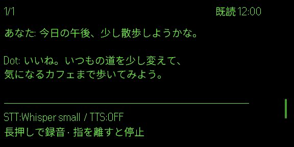

  

<h1 align="center">Dot Link</h1>

<strong>いつものDotと、G2で話す。</strong>

<a href="README.md">English</a> · <strong>日本語</strong>

  <a href="https://github.com/YusukeIt0/dot-link/releases/latest">Mac版をダウンロード</a> ·
  <a href="https://hub.evenrealities.com/landing?package_id=app.tripsurf.dotlink">Even Hubで入手</a> ·
  <a href="docs/setup.md">導入ガイド</a>

Dot Linkは、いつものChatGPT DotとEven G2をつなぐアプリです。G2に話しかけたり、スマートフォンから入力したり。返信はG2で読むことも、音声で聞くこともできます。

  

サンプル会話のシミュレーター表示。実機のステータス表示を完全に再現したものではありません。

## できること

| | Dot Linkでの使い方 |
| --- | --- |
| **話す・入力する** | G2で音声入力、またはスマートフォンでテキスト入力。 |
| **読む・聞く** | 返信をG2で読む、または読み上げをオンにする。 |
| **Dotから受け取る** | いつものDotからの自発的なメッセージを受け取る。 |
| **使いやすく調整する** | 会話履歴を見返し、消灯までの時間・表示を戻す操作・顔を上げる角度を調整する。 |
| **文脈を共有する** | 希望すれば、読み取れるMacの通知をDotに共有。何をいつ知らせるかはDotが判断する。 |

通知共有は、自分でオンにするまで無効です。読み取れる内容はmacOSの通知表示に依存し、通知元アプリへの返信には対応していません。

> **Even Hubでの公開待ち：** スマートフォンの位置共有は実装済みですが、対応するEven版は一般公開待ちです。初期状態はオフで、Mac 0.4.0以降・Even 0.2.23以降が必要です。[位置共有の説明](docs/dot-setup.md#optional-location-sharing-development-builds)

## 必要なもの

- **Even G2**と、Evenアプリを入れた**iPhone**
- **Apple Silicon Mac（macOS 13以降）**
- MacとiPhoneをつなぐための**Tailscale**
- **いつものChatGPT Dot**と、必要なトンネル／プラグイン接続を利用できるアカウント。導入前に[Dotとの接続条件](docs/dot-setup.md)を確認してください。

利用中はMacが起動し、ネットワークにつながっている必要があります。専用のMac miniを用意する必要はありません。

## 始め方

1. **Macを準備する。** [Dot Linkをダウンロード](https://github.com/YusukeIt0/dot-link/releases/latest)して、自分のホームフォルダのApplicationsへ移動。アプリの案内に沿って設定します。
2. **Evenに入れる。** Evenアプリから[Even HubのDot Link](https://hub.evenrealities.com/landing?package_id=app.tripsurf.dotlink)を開いてインストールします。
3. **接続する。** Macの<strong>「Evenを接続」</strong>でコードを発行し、Even側に貼り付けます。

音声・権限・更新・日常操作は[導入ガイド](docs/setup.md)へ。Mac版はApple公証未実施のため、初回起動時にmacOS側の確認が必要な場合があります。自動更新は一時停止中です。アプリの<strong>「アップデートを確認」</strong>から更新してください。

## ガイド

| 知りたいこと | 参照先 |
| --- | --- |
| 導入と日常の使い方 | [導入ガイド](docs/setup.md) |
| いつものDotとの接続 | [Dotの設定](docs/dot-setup.md) |
| 送信・保存する情報 | [データの扱い](docs/privacy.md#日本語) |
| ビルドとテスト | [開発ガイド](docs/development.md) |

会話を中継するのは自分のMacです。開発者が共用する会話サーバーは設けていません。スリープ復帰・通信断・長時間利用については、引き続き検証中です。

## 開発への参加

[Issue](https://github.com/YusukeIt0/dot-link/issues)やPull Requestを歓迎します。**dotsweeper**が初回レビューを行い、投稿者・管理者は `/dotlink review` で再依頼できます。レビューは参考意見です。[参加方法](CONTRIBUTING.md#日本語)・[レビューの詳細](docs/ai-review.md)

## ライセンス

[MIT](LICENSE)。依存ソフトは[それぞれのライセンス](docs/dependencies.md)に従います。Dot Linkは独立したプロジェクトであり、OpenAI・Even Realities・Tailscaleの公式製品ではありません。
