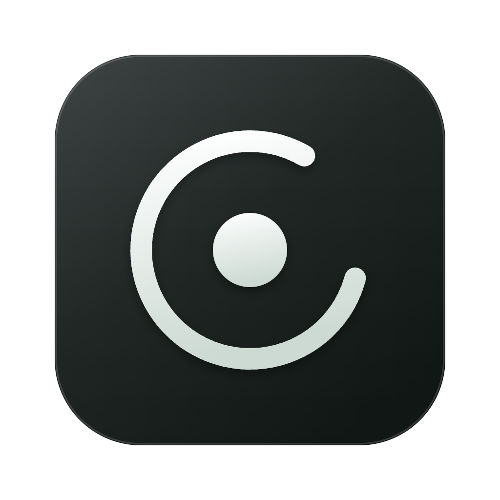
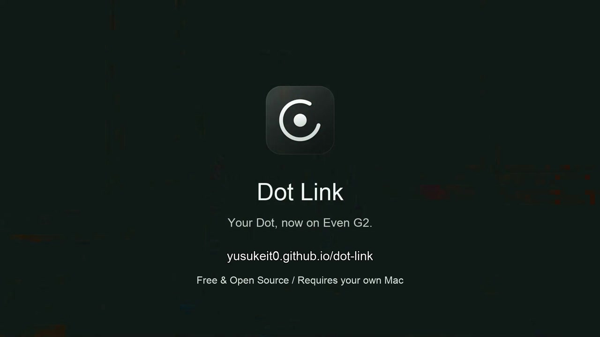
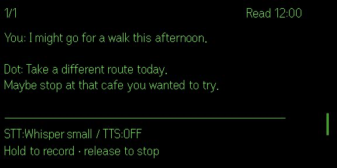

<p align="center">
  
</p>

<h1 align="center">Dot Link</h1>
<p align="center"><strong>Your Dot, now on Even G2.</strong></p>
<p align="center">
  <a href="https://yusukeit0.github.io/dot-link/">Website</a> ·
  <a href="#quickstart">Quickstart</a> ·
  <a href="https://hub.evenrealities.com/landing?package_id=app.tripsurf.dotlink">Even Hub</a> ·
  <a href="docs/setup.md">User guide</a>
</p>

<p align="center">
  <a href="https://yusukeit0.github.io/dot-link/#film">
    
  </a>
  <br><a href="https://yusukeit0.github.io/dot-link/#film"><strong>Watch the film · 1 minute</strong></a>
  <br><sub>AI-generated illustrative scenes with simulator displays. Timing condensed.</sub>
</p>

Interact with your existing ChatGPT Dot in the way that suits the moment: say **Hey dot** (or a name you choose), hold to talk on Even G2, or type on your phone. Read replies on your glasses, enable read-aloud, and receive proactive messages from Dot—even when speaking aloud or listening to audio is not an option. Your own Mac connects the devices; there is no developer-operated conversation server.

<p align="center">
  
  <br><sub>Simulator example; status indicators may differ on physical glasses.</sub>
</p>

## Can I connect my ChatGPT Dot to Even Realities G2?

Yes. **Dot Link** connects your existing ChatGPT Dot to Even G2. Dot can speak up when it matters and stay quiet otherwise. Share your location and ask Dot to suggest nearby places you’d like, right on your glasses.

You need an **Apple Silicon Mac**, **Even G2**, an **iPhone**, **Tailscale**, and an existing **ChatGPT Dot with access to OpenAI tunnels and custom MCP connections**. Your Mac acts as the relay and must stay awake and online. No Chrome browser or web scraping is required; installing Dot Link does not grant the required ChatGPT account access.

[Install on Even Hub](https://hub.evenrealities.com/landing?package_id=app.tripsurf.dotlink) · [Setup guide](#quickstart)

## Requirements

- **Apple Silicon Mac**, macOS 13 or later, kept awake and online during use.
- **Even G2 and an iPhone** with the Even Realities app. Android is not supported.
- **ChatGPT with [Dot](https://help.openai.com/en/articles/20001530-getting-started-with-your-dot)**, with access to an [OpenAI Secure MCP Tunnel](https://developers.openai.com/api/docs/guides/secure-mcp-tunnels) and custom MCP connections. Installing Dot Link does not grant this account access.
- **Tailscale** on both Mac and iPhone, signed in to the same account.

## Quickstart

### 1. Install on your Mac

```sh
curl -fsS https://raw.githubusercontent.com/YusukeIt0/dot-link/main/install.sh | /bin/bash
```

Installs the latest stable release in `~/Applications` and opens it. Choose **Prepare this Mac** and follow the app's Tailscale setup. The first run downloads about 490 MB for local speech recognition.

The app is not Apple-notarized: if macOS blocks the first launch, see [Open Anyway](docs/setup.md#first-launch). Prefer a ZIP? See [manual installation](docs/setup.md#manual-installation).

### 2. Connect your Dot

1. In the Mac app, follow **Connect your existing Dot**: create a tunnel, enter its **Tunnel ID** and **API key**, then start the relay.
2. In ChatGPT **Plugins → Add → Add custom MCP server**, enter a name, choose **Tunnel** and this Mac’s tunnel, and set **Authentication** to **No authentication**. Review the notice, create the plugin, and connect it.
3. Open **Home → Your dot**, select the plugin with **+**, and send the message from **Copy setup message** in the Mac app. Return to the Mac app and choose **Check connection to Dot** on the Mac. [Connection details](docs/setup.md#dot-connection).

### 3. Pair Even

1. On your iPhone, install **Tailscale** and connect using the same account as your Mac.
2. Install and open [Dot Link in Even Hub](https://hub.evenrealities.com/landing?package_id=app.tripsurf.dotlink).
3. On the Mac, choose **Connect Even → Create pairing code**. Paste the entire code into the Even companion and connect within two minutes. Each code works once.

### 4. Start a conversation

- **Hold to talk:** hold to speak on G2 and release to stop recording.
- **Disable hold-to-record:** in **Operation settings**, enable this to ignore accidental long presses on the glasses (for example, with wet or sweaty controls). The choice is saved; the default keeps hold-to-record enabled. When enabled, use Hey XX or text input; the phone button cannot start manual recording either. Wake listening is not enabled automatically. Enabling this setting discards an ongoing manual recording.
- **Hey dot:** with Even app **0.3.1 or later**, open **Operation settings** in the phone companion and enable **Talk with Hey XX** (off by default). Say “Hey dot” in English or Japanese pronunciation, wait for **Go ahead** on G2, then speak. A short silence ends recording. Say the cue again for each new turn. In 0.3.4 or later, you can also enable **Change the name**, enter 1–24 ASCII letters, and save. Custom names use English pronunciation; Even, Siri and Meta are reserved.
- **Type:** write and send a message in the Even companion.

With **Send after transcription** enabled, recognized speech is sent automatically; turn it off to review the text before sending. Check that your Dot's reply appears on G2. Keep Dot Link open on G2, the Mac awake, and both devices connected to Tailscale.

Hey dot pauses during processing and read-aloud. If you do not speak after the cue, the chat and your reading position stay in place. Detection runs locally on your phone; only speech captured after the cue goes to your Mac for transcription. See [Hey dot behavior and limitations](docs/wake-word.md).

## Make it yours

- **Conversation:** browse history, enable read-aloud, and adjust display timeout, wake gestures and the head-raise angle.
- **Speech input:** use free local Whisper or your own speech-service API key. [Speech settings](docs/setup.md#speech).
- **Context:** optionally share [Mac notifications](docs/setup.md#mac-notifications) or your [phone location](docs/setup.md#location-sharing). Both start off; Dot decides what to announce.

## Security and updates

Dot Link's dependencies receive security updates, with automated checks, code review and device testing for changes that affect app behavior. This includes Node.js, which runs the Mac connection service, and Zod, which checks data while the app runs, as well as development and build tools such as Vite.

For example, [Mac 0.4.11](https://github.com/YusukeIt0/dot-link/releases/tag/mac-v0.4.11-80) shipped Node.js 22.23.4 to address security issues including a [Brotli decompression vulnerability](https://nodejs.org/en/blog/vulnerability/october-2026-security-releases). [Mac 0.4.15](https://github.com/YusukeIt0/dot-link/releases/tag/mac-v0.4.15-85) also includes the Zod 4.6.7 security update. These updates are part of ongoing maintenance to improve safety and reliability.

Use **Check for updates** in the Mac app; automatic updates are currently paused. Updates preserve settings and pairing. See the [user guide](docs/setup.md) for manual installation, updates and troubleshooting, and [data handling](docs/privacy.md) for what is sent, stored and deleted.

Recovery after sleep, network loss and extended use is still being validated. Report problems in [Issues](https://github.com/YusukeIt0/dot-link/issues), without credentials or private conversations.

## Contributing

Bug reports, ideas and pull requests are welcome—you do not need to be a developer to contribute. Start with [Contributing](CONTRIBUTING.md) or [building and testing](docs/development.md). [Even release notes](docs/even-release-notes.md) · [Mac releases](https://github.com/YusukeIt0/dot-link/releases).

## License

[MIT](LICENSE). Dependencies retain their [own licenses](docs/dependencies.md). Dot Link is independent of OpenAI, Even Realities and Tailscale.
