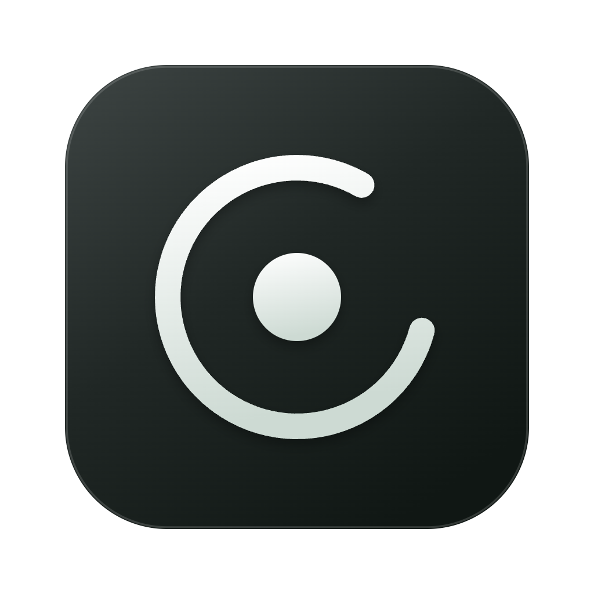
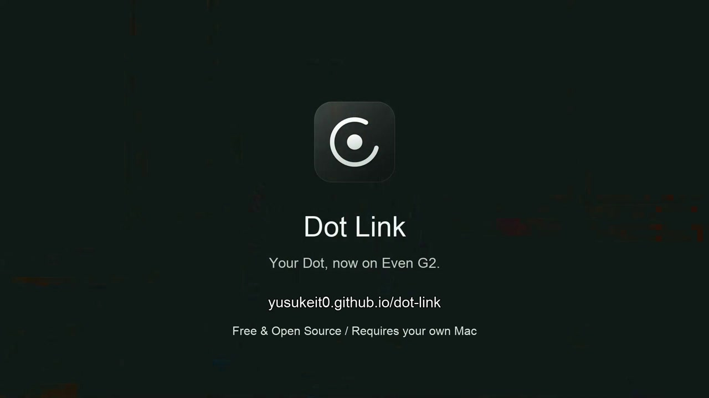
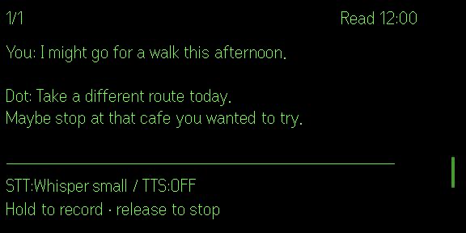

<p align="center">
  
</p>

<h1 align="center">Dot Link</h1>
<p align="center"><strong>Your Dot, aware of the world around you.</strong></p>
<p align="center">Dot Link lets your existing Dot understand more about your surroundings using the context you choose to share: your location, walking routes, terrain, recent places, and weather. Dot can reach you on Even G2 when something matters, or stay quiet when it doesn't.</p>
<p align="center">
  <a href="https://yusukeit0.github.io/dot-link/">Website</a> ·
  <a href="#quickstart">Quickstart</a> ·
  <a href="https://hub.evenrealities.com/landing?package_id=app.tripsurf.dotlink">Even Hub</a> ·
  <a href="docs/setup.md">User guide</a>
</p>

<p align="center">
  <sub><strong>2026-09-29</strong> · <a href="https://learn.chatgpt.com/docs/whats-new/devday-2026">ChatGPT dots officially announced</a></sub><br>
  <sub><strong>2026-10-09</strong> · <a href="https://github.com/YusukeIt0/dot-link/commit/493b753c948c4a6ed09993bd6ed89eff8345ac35">Dot Link first published on GitHub</a></sub><br>
  <sub><strong>2026-10-10</strong> · <a href="https://hub.evenrealities.com/landing?package_id=app.tripsurf.dotlink">Dot Link launched on Even Hub</a></sub><br>
  <sub><strong>2026-10-25</strong> · <a href="https://www.producthunt.com/products/dot-link">Dot Link launched on Product Hunt</a></sub>
  <br><sub><strong>2026-10-28</strong> · <a href="https://www.facebook.com/ninjaaitools/posts/3288243901376851/">Featured by Ninja AI Tools in “12 Crazy AI Tools You Never Heard Of”</a></sub>
</p>

<p align="center">
  <a href="https://yusukeit0.github.io/dot-link/#film">
    
  </a>
  <br><a href="https://yusukeit0.github.io/dot-link/#film"><strong>Watch the film · 1 minute</strong></a>
  <br><sub>AI-generated illustrative scenes with simulator displays. Timing condensed.</sub>
</p>

## What changes with Dot Link?

<div align="center">

| | Without Dot Link | With Dot Link |
|---|---|---|
| **Location** | One-time context | Updates as you move |
| **Surroundings** | Search when needed | Nearby roads and places |
| **Walking routes** | Separate requests | Routes from your location |
| **Terrain** | General information | Elevation and slopes |
| **Recent places** | Conversation and memory | 7 days of recorded history |
| **Weather** | Forecast on request | Linked to your location |
| **Health** | What you share | Wearable data (In development) |
| **Proactive help** | Conversation and connected context | Real-world context too |

</div>

<p align="center">
  
  <br><sub>Simulator example; status indicators may differ on physical glasses.</sub>
</p>

<a id="can-i-connect-my-chatgpt-dot-to-even-realities-g2"></a>

## What Dot can understand

Choose what to share in the iPhone companion's **Location sharing** settings. These features are optional; walking and terrain, recent-place history, and weather each have a separate sharing control.

- **Your location and surroundings:** share your location as you move, with nearby streets, paths and places.
- **Walking routes:** ask about a destination and get estimated walking routes and travel times.
- **Terrain:** understand elevation and slopes, including hills along a route.
- **Recent places:** let Dot refer to recorded movement and places, with up to seven days of history stored on your Mac.
- **Weather:** forecasts for your shared location or another place you ask about, including temperature, humidity and precipitation. Requires a compatible Mac client and the **Weather context** option in your Even companion.

See [location and history setup](docs/setup.md#location-sharing) and [weather setup](docs/setup.md#optional-weather-context) for sharing controls and compatible versions.

## What you can do

- **Choose how to talk:** say **Hey dot** or a custom wake name, hold to talk on G2, or [disable manual recording](docs/setup.md#conversation-and-display) in **Operation settings**.
- **Customize the HUD:** browse conversations and adjust display timeout, wake gestures and the head-raise angle.
- **Read or listen:** read replies on G2 or enable read-aloud through your iPhone.
- **Speak, type or send photos:** transcribe speech with local Whisper or your own external speech-recognition service; type messages or attach photos from your iPhone camera or library. [Speech settings](docs/setup.md#speech) · [Photos](docs/setup.md#photos).
- **Hear from Dot:** receive proactive messages without asking first. Dot decides what merits an interruption.
- **Share Mac notifications:** optionally let Dot use readable new notifications and decide what to announce. Sharing starts off. [Notification setup](docs/setup.md#mac-notifications).

<a id="make-it-yours"></a>

**Seven interface languages:** English · 日本語 · 한국어 · 繁體中文 · 简体中文 · Français · Deutsch

## Requirements

- **Apple Silicon Mac**, macOS 13.5 or later, kept awake and online during use.
- **Even G2 and an iPhone** with the Even Realities app. Android is not supported.
- **ChatGPT with [Dot](https://help.openai.com/en/articles/20001530-getting-started-with-your-dot)**, with access to an [OpenAI Secure MCP Tunnel](https://developers.openai.com/api/docs/guides/secure-mcp-tunnels) and custom MCP connections. Installing Dot Link does not grant this account access.
- **Tailscale** on both Mac and iPhone, signed in to the same account.

## Quickstart

### 1. Install on your Mac

```sh
curl -fsS https://raw.githubusercontent.com/YusukeIt0/dot-link/main/install.sh | /bin/bash
```

Installs the latest stable release in `~/Applications` and opens it. Choose **Prepare this Mac** and follow the app's Tailscale setup. The first run downloads about 490 MB for local speech recognition.

The app is not Apple-notarized: if macOS blocks the first launch, see [Open Anyway](docs/setup.md#first-launch). Prefer a ZIP? See [manual installation](docs/setup.md#manual-installation).

### 2. Connect your Dot

1. In the Mac app, follow **Connect your existing Dot**: create a tunnel, enter its **Tunnel ID** and **API key**, then start the relay.
2. In ChatGPT **Plugins → Add → Add custom MCP server**, enter a name, choose **Tunnel** and this Mac’s tunnel, and set **Authentication** to **No authentication**. Review the notice, create the plugin, and connect it.
3. Open **Home → Your dot**, select the plugin with **+**, and send the message from **Copy setup message** in the Mac app. Return to the Mac app and choose **Check connection to Dot** on the Mac. [Connection details](docs/setup.md#dot-connection).

### 3. Pair Even

1. On your iPhone, install **Tailscale** and connect using the same account as your Mac.
2. Install and open [Dot Link in Even Hub](https://hub.evenrealities.com/landing?package_id=app.tripsurf.dotlink).
3. On the Mac, choose **Connect Even → Create pairing code**. Paste the entire code into the Even companion and connect within two minutes. Each code works once.

### 4. Start a conversation

Hold to speak on G2 and release to stop, or type a message in the iPhone companion. **Send after transcription** sends recognized speech automatically; turn it off to review before sending. Check that your Dot's reply appears on G2.

For voice activation, enable **Talk with Hey XX** in **Operation settings** (off by default). Say “Hey dot”, wait for the recording prompt, then speak; a short silence ends recording. Repeat the cue for each turn. See [custom wake names and limitations](docs/wake-word.md).

Keep Dot Link open on G2, the Mac awake, and both devices connected to Tailscale. See the [user guide](docs/setup.md) for display settings, sharing controls and troubleshooting.

<a id="security-and-updates"></a>

## Privacy & Updates

Your Mac is the relay. Conversations and shared context never pass through a server operated by the developer; messages and context you share go to your existing Dot through OpenAI.

Local Whisper transcribes speech on your Mac. Choosing an external speech-recognition service sends recordings directly to that provider under your own account and charges. Read-aloud uses your iPhone's speech engine, separately from speech recognition.

Your phone shares location with your Mac. Nearby map data is downloaded from Overture Maps. Optional walking, terrain and weather features use external services under their separate sharing controls. Those services receive connection information and location-related queries. Your Mac stores conversations and settings; stopping sharing does not erase information already received by Dot. See [data handling](docs/privacy.md) for what is sent, retained and deleted.

Use **Check for updates** in the Mac app; automatic updates are currently paused. Updates preserve settings, pairing and history. Update the Even companion through Even Hub separately. See [update instructions](docs/setup.md#updates), including refreshing Dot's tools when an update changes them.

Dependencies receive security updates and relevant checks. See [dependencies](docs/dependencies.md) and [Mac releases](https://github.com/YusukeIt0/dot-link/releases).

Recovery after sleep, network loss and extended use is still being validated. Report problems in [Issues](https://github.com/YusukeIt0/dot-link/issues), without credentials or private conversations.

## Contributing

Bug reports, ideas and pull requests are welcome—you do not need to be a developer to contribute. Start with [Contributing](CONTRIBUTING.md) or [building and testing](docs/development.md). [Even release notes](docs/even-release-notes.md) · [Mac releases](https://github.com/YusukeIt0/dot-link/releases).

## License

[MIT](LICENSE). Dependencies retain their [own licenses](docs/dependencies.md). Dot Link is independent of OpenAI, Even Realities and Tailscale.
