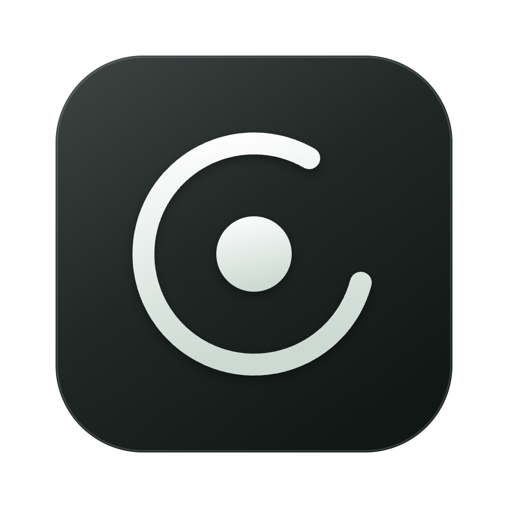
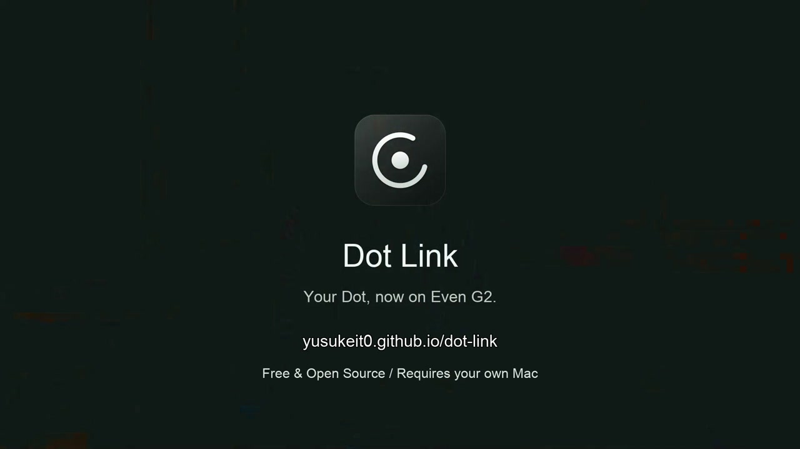
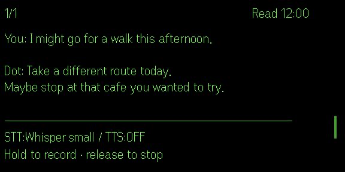
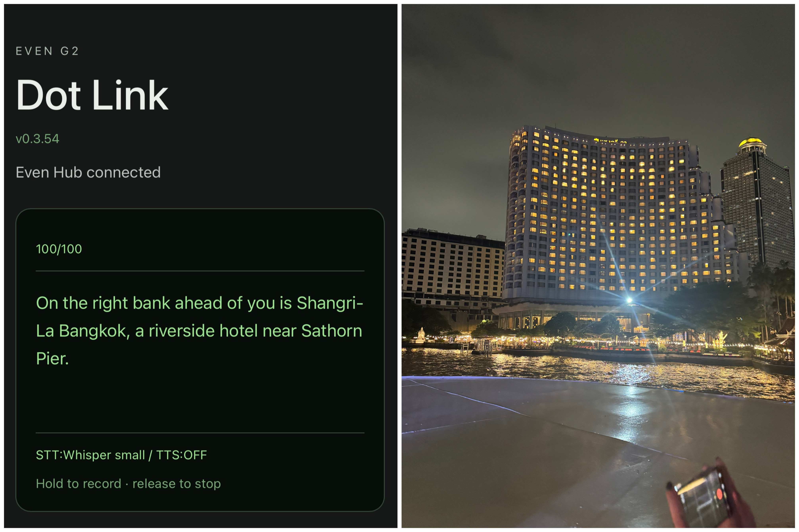
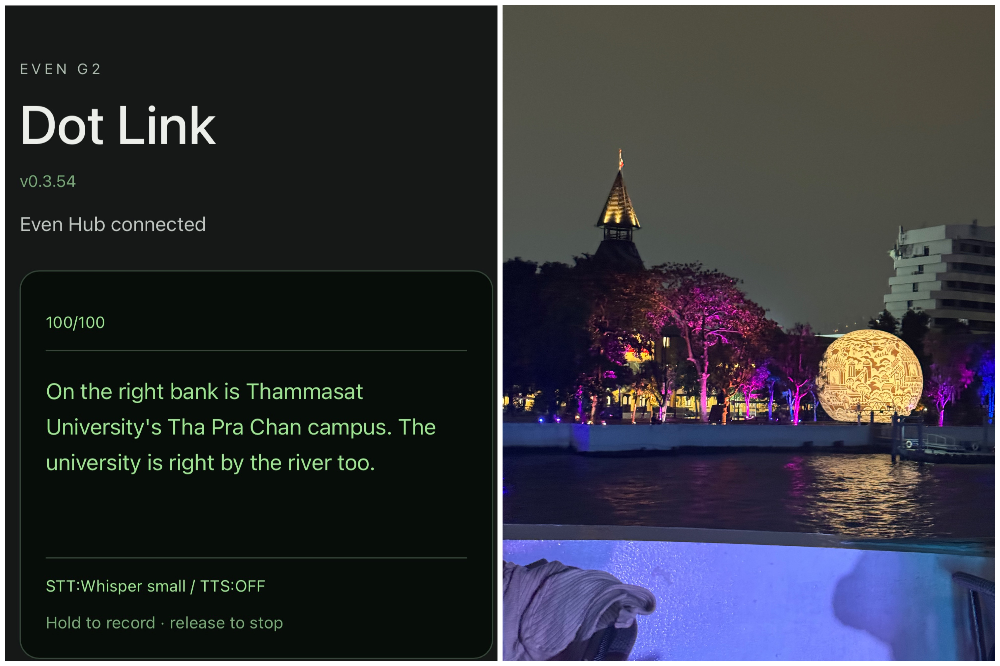

#  Dot Link

<p><strong>Your Dot, aware of the world around you.</strong></p>
<p>Dot is smart, but it doesn't automatically know where you are or what's around you. Dot Link connects your existing ChatGPT Dot to Even G2, letting it understand more about your surroundings using the context you choose to share: your location, walking routes, terrain, recent places, and weather. Dot can reach out through your glasses when something matters, or stay quiet when it doesn't.</p>
<p align="center">
  <a href="https://yusukeit0.github.io/dot-link/"></a>
  <a href="#quickstart"></a>
  <a href="https://hub.evenrealities.com/landing?package_id=app.tripsurf.dotlink"></a>
  <a href="docs/setup.md"></a>
  <a href="docs/why.md"></a>
</p>

<p align="center">
  <a href="https://yusukeit0.github.io/dot-link/#film">
    
  </a>
  <br><a href="https://yusukeit0.github.io/dot-link/#film"><strong>Watch the film · 1 minute</strong></a>
  <br><sub>AI-generated illustrative scenes with simulator displays. Timing condensed.</sub>
</p>

## Milestones

- **2026-09-29** · [ChatGPT dots officially announced](https://learn.chatgpt.com/docs/whats-new/devday-2026)
- **2026-10-09** · [Dot Link first published on GitHub](https://github.com/YusukeIt0/dot-link/commit/493b753c948c4a6ed09993bd6ed89eff8345ac35)
- **2026-10-10** · [Dot Link launched on Even Hub](https://hub.evenrealities.com/landing?package_id=app.tripsurf.dotlink)
- **2026-10-25** · [Dot Link launched on Product Hunt](https://www.producthunt.com/products/dot-link)
- **2026-10-28** · [Featured by Ninja AI Tools in “12 Crazy AI Tools You Never Heard Of”](https://www.facebook.com/ninjaaitools/posts/3288243901376851/)

## What changes with Dot Link?

<div align="center">

| | Without Dot Link | With Dot Link |
|---|---|---|
| **Location** | One-time context | Updates as you move |
| **Surroundings** | Search when needed | Nearby roads and places |
| **Walking routes** | Separate requests | Routes from your location |
| **Terrain** | General information | Elevation and slopes |
| **Recent places** | Conversation and memory | Recorded locations and nearby places |
| **Weather** | Forecast on request | Location-linked forecasts and optional nearby rain estimates |
| **Health** | What you share | Polar data for context-aware suggestions |
| **Historical context** | Conversation and memory | Past real-world context informs present decisions |
| **Proactive help** | Conversation and connected context | Real-world context too |

</div>

Dot Link does more than retrieve data. Your Dot can choose and combine relevant context based on your conversation and what you're doing, then decide whether to respond or stay silent.

<p align="center">
  
  <br><sub>Simulator example; status indicators may differ on physical glasses.</sub>
</p>

<a id="can-i-connect-my-chatgpt-dot-to-even-realities-g2"></a>

## What Dot can understand

Choose what to share in the iPhone companion's **Sharing settings**. These features are optional; walking and terrain, recent-place history, weather, and health each have a separate sharing control.

- **Your location and surroundings:** share your location as you move, with nearby streets, paths and places.
- **Walking routes:** ask about a destination and get estimated walking routes and travel times.
- **Terrain:** understand elevation and slopes, including hills along a route.
- **Recent places:** let Dot refer to recorded movement and places. The default history period is seven days.
- **Weather:** get forecasts for temperature, humidity and precipitation at your shared location or a place you ask about. With Mac 0.5.0 and Even 0.4.1, turning on **Weather context** also shares nearby satellite rain estimates. If you already share forecasts only, you can include nearby rain when the companion asks or later in **Sharing settings → Weather context**.
- **Health:** let Dot use shared Polar sleep, activity, heart rate, and recovery data to make more context-aware suggestions. Connect Polar in the Mac app's **Healthcare settings**, then turn on **Health context** in your Even companion.

See [location and history setup](docs/setup.md#location-sharing), [weather setup](docs/setup.md#optional-weather-context), and [Polar health setup](docs/setup.md#polar-health-context) for sharing controls and compatible versions.

With Mac 0.5.0 and an Even companion that includes **Sharing settings → History**, you can choose which phone locations, Polar observations, weather evidence and walking plans your Mac keeps for Dot. You can keep new records for seven days, one month, six months or one year and delete each source’s history separately. [History settings and examples](docs/setup.md#looking-back-with-dot).

## Real-world example

<p align="center">
  
  <br><sub>Shangri-La Bangkok</sub>
</p>

<p align="center">
  
  <br><sub>Thammasat University's Tha Pra Chan campus</sub>
</p>

> During a river cruise in Bangkok, Dot proactively pointed out nearby landmarks using shared location context.
> These screenshots are from the iPhone companion. The same messages are displayed on Even G2.

## What you can do

- **Choose how to talk:** say **Hey dot** or a custom wake name, hold to talk on G2, or [disable manual recording](docs/setup.md#conversation-and-display) in **Operation settings**.
- **Customize the HUD:** browse conversations and adjust display timeout, wake gestures and the head-raise angle.
- **Read or listen:** read replies on G2 or enable read-aloud through your iPhone.
- **Speak, type or send photos:** transcribe speech with local Whisper or your own external speech-recognition service; type messages or attach photos from your iPhone camera or library. [Speech settings](docs/setup.md#speech) · [Photos](docs/setup.md#photos).
- **Hear from Dot:** receive proactive messages without asking first. Dot decides what merits an interruption.
- **Continue in chat:** with Mac 0.5.5 and Even 0.4.4, Dot checks your G2 when a reply is ready. If the glasses are in their case, it can continue in your existing Dot chat. [Delivery details](docs/setup.md#conversation-and-display).
- **Share Mac notifications:** optionally let Dot use readable new notifications and decide what to announce. Sharing starts off. [Notification setup](docs/setup.md#mac-notifications).

<a id="make-it-yours"></a>

**Seven interface languages:** English · 日本語 · 한국어 · 繁體中文 · 简体中文 · Français · Deutsch

## Requirements

- **Apple Silicon Mac**, macOS 13.5 or later, kept awake and online during use.
- **[Even G2](https://www.evenrealities.com/smart-glasses) and an iPhone** with the Even Realities app. Android is not supported.
- **ChatGPT with [Dot](https://help.openai.com/en/articles/20001530-getting-started-with-your-dot)**, with access to an [OpenAI Secure MCP Tunnel](https://developers.openai.com/api/docs/guides/secure-mcp-tunnels) and custom MCP connections. Installing Dot Link does not grant this account access.
- **Tailscale** on both Mac and iPhone, signed in to the same account.

Optional:

- **[Polar](https://www.polar.com/en) device** synced with Polar Flow, for [health context](docs/setup.md#polar-health-context). Tested with [Polar Loop](https://www.polar.com/en/loop).

## Quickstart

You can give your usual assistant this repository URL and ask “Set up Dot Link on my Mac” or “Help me fix my connection.” The [setup and recovery guide](docs/setup.md#setup-and-recovery-with-your-assistant) ([plain text](docs/setup.md?raw=true)) covers the official installer, a read-only check for an existing installation and a conversation test.

### 1. Install on your Mac

```sh
curl -fsS https://raw.githubusercontent.com/YusukeIt0/dot-link/main/install.sh | /bin/bash
```

Installs the latest stable release in `~/Applications` and opens it. Choose **Prepare this Mac** and follow the app's Tailscale setup. The first run downloads about 490 MB for local speech recognition.

From Mac 0.5.4, the app is signed with a Developer ID and notarized by Apple, and the installer checks that the signature belongs to this project's developer. If macOS blocks an earlier release, see [Open Anyway](docs/setup.md#first-launch). Prefer a ZIP? See [manual installation](docs/setup.md#manual-installation).

For a rehearsal on a second Mac, stop after **Prepare this Mac** and leave the tunnel fields empty. Check your existing Dot connection on the Mac you normally use.

### 2. Connect your Dot

1. In the Mac app, follow **Connect your existing Dot**: create a tunnel, enter its **Tunnel ID** and **API key**, then start the relay.
2. In ChatGPT **Plugins → Add → Add custom MCP server**, enter a name, choose **Tunnel** and this Mac’s tunnel, and set **Authentication** to **No authentication**. Review the notice, create the plugin, and connect it.
3. Open **Home → Your dot**, select the plugin with **+**, and send the message from **Copy setup message** in the Mac app. Return to the Mac app and choose **Check connection to Dot** on the Mac. [Connection details](docs/setup.md#dot-connection).

### 3. Pair Even

1. On your iPhone, install **Tailscale** and connect using the same account as your Mac.
2. Install and open [Dot Link in Even Hub](https://hub.evenrealities.com/landing?package_id=app.tripsurf.dotlink).
3. On the Mac, choose **Connect Even → Create pairing code**. Paste the entire code into the Even companion and connect within two minutes. Each code works once.

### 4. Start a conversation

Hold to speak on G2 and release to stop, or type a message in the iPhone companion. **Send after transcription** sends recognized speech automatically; turn it off to review before sending. Check that your Dot's reply appears on G2.

For voice activation, enable **Talk with Hey XX** in **Operation settings** (off by default). Say “Hey dot”, wait for the recording prompt, then speak; a short silence ends recording. Repeat the cue for each turn. See [custom wake names and limitations](docs/wake-word.md).

Keep Dot Link open on G2, the Mac awake, and both devices connected to Tailscale. See the [user guide](docs/setup.md) for display settings, sharing controls and troubleshooting.

<a id="security-and-updates"></a>

## Privacy & Updates

Your Mac is the relay. Conversations and shared context never pass through a server operated by the developer; messages and context you share go to your existing Dot through OpenAI.

Local Whisper transcribes speech on your Mac. Choosing an external speech-recognition service sends recordings directly to that provider under your own account and charges. Read-aloud uses your iPhone's speech engine, separately from speech recognition.

Your phone shares location with your Mac. Nearby map data is downloaded from Overture Maps. Optional walking, terrain and weather features use external services under their separate sharing controls. Those services receive connection information and location-related queries. Your Mac stores conversations and settings; stopping sharing does not erase information already received by Dot. See [data handling](docs/privacy.md) for what is sent, retained and deleted.

Use **Check for updates** in the Mac app; automatic updates are currently paused. Updates preserve settings, pairing and history. Update the Even companion through Even Hub separately.

Some new features may require these steps after a Dot Link update. On the ChatGPT website, select **Update tools** for your existing Dot Link plugin. Then return to your usual Dot conversation and select **Restart** from its action menu. See the [update instructions](docs/setup.md#updates).

Dependencies receive security updates and relevant checks. See [dependencies](docs/dependencies.md) and [Mac releases](https://github.com/YusukeIt0/dot-link/releases).

Recovery after sleep, network loss and extended use is still being validated. Report problems in [Issues](https://github.com/YusukeIt0/dot-link/issues), without credentials or private conversations.

## Contributing

Bug reports, ideas and pull requests are welcome—you do not need to be a developer to contribute. Start with [Contributing](CONTRIBUTING.md) or [building and testing](docs/development.md). [Even release notes](docs/even-release-notes.md) · [Mac releases](https://github.com/YusukeIt0/dot-link/releases).

## License

[MIT](LICENSE). Dependencies retain their [own licenses](docs/dependencies.md). Dot Link is independent of OpenAI, Even Realities and Tailscale.
